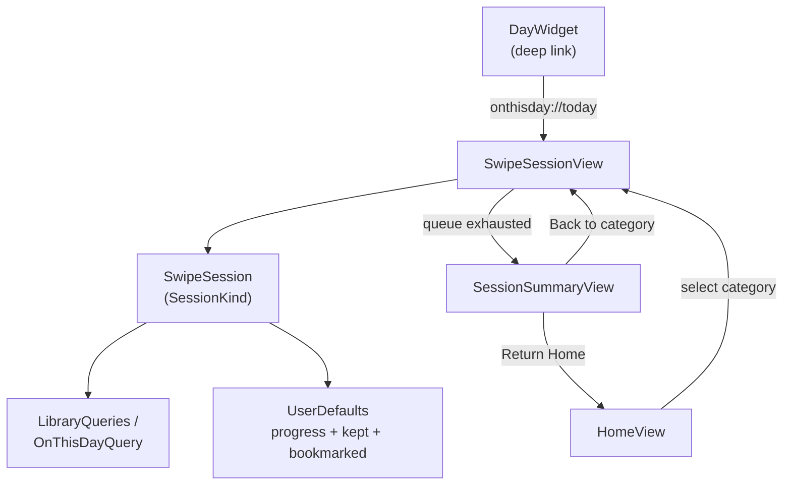

# Swipewipe-Style Redesign - Plan

## Goal Capsule

- **Objective:** Patrick can clean up his photo library from a Home screen covering On This Day, Recents, Random, Bookmarked, and monthly albums — each with progress that survives closing the app, quick Favorite/Share/Bookmark actions, autoplaying videos, and a completion summary — instead of only a single on-this-day swipe screen.
- **Means:** Generalize the existing on-this-day swipe mechanic into a category-driven architecture (a `SessionKind`-parametrized session object) backing a new Home screen (KTD1).
- **Authority hierarchy:** Product Contract Requirements govern product behavior; Planning Contract KTDs govern implementation mechanism within those requirements; Implementation Units carry out both and override neither.
- **Stop conditions:** If an implementation unit would require a product-scope change not covered by a Requirement below, stop and raise it rather than deciding solo.
- **Execution profile:** Solo hobby project, no CI. Verification is manual, on-device (see Assumptions — no XCTest target exists).
- **Finishes and ships:** The implementing agent builds and smoke-tests each unit on-device; Patrick does the final verification pass and commits.

---

## Product Contract

### Summary

Rebuilds OnThisDay around a Home screen with multiple swipeable categories instead of one single-purpose screen, adds Favorite/Share/Bookmark actions and resumable progress to every swipe session, adds video autoplay with a speed control, and closes each session with a summary screen.

### Problem Frame

The app currently does one thing: swipe through today's photos from past years, nothing else. Patrick used a reference app (swipewipe) that does the same job with more categories to browse (not just today's date), richer per-card actions, and a completion summary that makes a session feel finished — and wants OnThisDay to match that experience for the parts that fit this app's single-purpose scope.

### Key Decisions

- **Recents and Random are real, working categories, not just Home-screen styling.** Chosen over keeping Home scoped to On This Day only. (session-settled: user-directed — chosen over a styling-only Home screen: the reference app's value is in having more to browse, not just a prettier entry point) — Governs R1.
- **Month-grouped rows are included; duplicate detection is not.** Chosen over building perceptual-similarity duplicate matching. (session-settled: user-directed — chosen over adding duplicates: month browsing reuses the existing date-query pattern cheaply, duplicate detection does not) — Governs R1, and the Scope Boundaries duplicates exclusion below.
- **Favorite, Share, and Bookmark are added; photo-editing/enhance tools are not.** (session-settled: user-directed — chosen over also building edit/enhance tools: those three are cheap wins against real iOS APIs, editing is a from-scratch feature) — Governs R4.
- **The reference app's bottom tab bar and multi-day catch-up tabs are excluded.** The existing date picker already covers date selection, and this app has no grid/AI-tools/profile destinations for a tab bar to serve. (session-settled: user-approved — chosen over replicating the reference app's full chrome: those destinations don't exist in this app) — Governs the Scope Boundaries bottom-tab-bar and catch-up-tabs exclusions below.

### Requirements

**Navigation & Categories**
- R1. A Home screen is the app's launch destination, listing: On This Day, Recents, Random, Bookmarked, then one row per month that has photos (newest month first). Each row shows a count and navigates into a swipe session for that category.

**Session Mechanics**
- R2. Every category is driven by one shared session implementation (no per-category duplication of keep/delete/undo logic).
- R3. A session's progress (queue, current position, and decisions made) persists across app relaunch, per category.

**Swipe Actions**
- R4. The swipe card has Favorite (toggles the real Photos-app favorite flag), Share (iOS share sheet), and Bookmark (app-internal saved-for-later list, surfaced as its own Home row) actions.
- R5. Dragging a card shows a KEEP/DELETE label that grows and a background tint that strengthens as the drag progresses.

**Video**
- R6. A video card autoplays and loops while it is the front card, and has a bottom-left control that cycles playback speed 1x → 1.5x → 2x → 1x.

**Session Completion**
- R7. Once a session's queue is exhausted, a summary screen shows kept/deleted tallies and an estimated space-freed figure, with "Back to [category]" and "Return Home" actions.

**Navigation Cleanup**
- R8. The swipe screen's overflow menu no longer has a "Today" item (Home now serves that role for every category); the "Show photos I kept" toggle moves to Home.
- R9. Tapping the Home Screen widget opens directly into an On This Day session, not the app's Home screen.

### Scope Boundaries

- **Duplicate photo detection** — considered and excluded; needs real perceptual-similarity matching, not a date/metadata query like every other category here. (Governs: Key Decisions above)
- **Photo editing / enhance tools** — considered and excluded; a from-scratch photo editor is a different scope of feature than the three swipe-card actions this plan adds. (Governs: Key Decisions above)
- **Multi-day catch-up tabs** (the reference app's OCT 12 / OCT 13 strip) — excluded; this app's existing `DatePicker` already covers picking a date.
- **Bottom tab bar** (reference app's grid/AI-tools/profile icons) — excluded; none of those destinations exist in this app.

### Success Criteria

- Every category (On This Day, Recents, Random, Bookmarked, each month row) can be opened from Home and swiped through with working keep/delete/undo.
- Closing the app mid-session and reopening it resumes at the same card with the same decisions intact, for every category.
- A video card autoplays, loops, and its speed control visibly changes playback rate.
- The summary screen's kept/deleted counts and space-freed figure are accurate against what was actually swiped and deleted.
- `xcodegen` regenerates the project and `xcodebuild` succeeds for both the `OnThisDay` and `OnThisDayWidget` targets after every unit.

---

## Planning Contract

### Key Technical Decisions

- KTD1. **`SwipeSession` replaces `DayDeck`, parametrized by a `SessionKind` enum** (`.onThisDay(Date)`, `.recents`, `.random(Date)`, `.month(Date)`, `.bookmarked`), with one shared keep/delete/undo/persistence implementation and a `switch` over `SessionKind` for the actual `PHAsset` query. (session-settled: user-approved — chosen over per-category deck subclasses: avoids duplicating swipe/undo/persistence logic four times, and over fully generic closures: keeps each category's query visible and debuggable as an enum case) — Governs R2.
- KTD2. **Progress persists via `UserDefaults`, keyed by a session-kind string** (e.g. `onThisDay-2026-10-13`, `recents`, `random-2026-10-13`, `month-2026-09`, `bookmarked`), storing the queue's asset identifiers, current index, and per-asset decisions. (session-settled: user-approved — chosen over introducing Core Data or a file-based store: matches this app's existing minimal-dependency pattern, see `kept` in the current `DayDeck`) — Governs R3.
- KTD3. **Random generates one batch per calendar day and persists it under that day's key**, rather than reshuffling on every open. (session-settled: user-approved — chosen over reshuffle-on-open: makes Random resumable the same way every other category is) — Governs R1.
- KTD4. **Recents is a fixed-size batch of the most recent ~50 photos/videos by creation date**, not a rolling time window. (session-settled: user-approved — chosen over a calendar-window query: gives a predictable, bounded session size) — Governs R1.
- KTD5. **Video plays via `PHImageManager.requestPlayerItem(forVideo:)` → `AVPlayerItem` → a plain `AVPlayer`, rendered through a custom `AVPlayerLayer`-backed view, not AVKit's `VideoPlayer`.** `AVPlayerItem` is the PhotoKit-recommended request type over `AVAsset` for reliability (see Sources & Research); a custom player view is needed because `VideoPlayer`'s stock scrubber/control chrome would conflict with the bottom-left speed control and the card's drag gesture — Governs R6.
- KTD6. **The summary screen's space-freed figure sums each deleted asset's `PHAssetResource` `fileSize`** (captured per-asset immediately before the delete call), not a rough per-photo average. This is a long-standing community KVC pattern, not documented public API (see Sources & Research and Risks & Dependencies). (session-settled: user-approved — chosen over an average-per-photo estimate: gives an accurate figure at a small, well-established API risk) — Governs R7.
- KTD7. **Bookmark state is a new `bookmarked` `UserDefaults` string set**, following the exact pattern of the existing `kept` set, surfaced as its own Home row by fetching `PHAsset`s for the stored identifiers. Chosen over a new persistence mechanism (e.g. a small on-disk JSON file) — a second string set costs nothing new and keeps every piece of app state in the same place — Governs R4.
- KTD8. **"Today" is removed from the overflow menu; "Show photos I kept" moves to a Home-screen control.** (session-settled: user-approved) — Governs R8.

### High-Level Technical Design

### Assumptions

- No XCTest target exists in this project today, and adding one with `PHPhotoLibrary` mocking is a separate undertaking this plan does not include. Every unit's test scenarios below are manual, on-device checks — the same way the app has been verified to date.
- Video autoplay's audio policy (muted-while-browsing vs. audible) is left to implementation; default to muted to match standard iOS photo-gallery UX unless that reads badly on-device.
- "Recents" batch size (~50) and the speed steps (1x/1.5x/2x) are reasonable defaults, not firm requirements — easy to adjust if they feel wrong once built.

### Risks & Dependencies

- **`PHAssetResource` `fileSize` is undocumented KVC, not public API** (KTD6). If a future iOS removes or renames it, `fileSize` silently returns `0` rather than crashing — the summary screen would read "0 MB saved" instead of erroring. Mitigation: if a build's lookup returns `0` for every deleted asset in a session with real deletions, show "space freed unavailable" instead of "0 MB" rather than presenting a wrong number as if it were real.

### Sources & Research

- `PHImageManager.requestPlayerItem(forVideo:)` returning an `AVPlayerItem` is the PhotoKit-recommended way to play a video `PHAsset` (more reliable than requesting a raw `AVAsset`) — shapes KTD5.
- `PHAssetResource.assetResources(for:).first?.value(forKey: "fileSize")` is the standard (if KVC-based, undocumented) way to get a `PHAsset`'s real byte size without loading its full image data — shapes KTD6.

---

## Implementation Units

### U1. Shared Swipe Session Core

**Goal:** Generalize the single on-this-day deck into a session class usable by every category, with persisted progress.
**Requirements:** R2, R3 (KTD1, KTD2)
**Dependencies:** none
**Files:**
- `App/DayDeck.swift` → replace with new `App/SwipeSession.swift`
- `Shared/OnThisDayQuery.swift` (unchanged; becomes the `.onThisDay` query)
- new `Shared/LibraryQueries.swift` (recents / random / month queries, plus fetch-by-identifiers for bookmarked)

**Approach:**
- Define `SessionKind` per KTD1, with a `storageKey` computed property for KTD2.
- Port `DayDeck`'s `@Published` shape (assets, history, isLoading, authorization) onto `SwipeSession`, driven by `kind` instead of `date`.
- `reload()` switches on `kind` to call the matching query (`OnThisDayQuery.assets`, or the new `LibraryQueries` functions).
- On every `decide()`/`undo()`, persist `{queueIdentifiers, currentIndex, decisions}` under `kind.storageKey` (KTD2); on `start()`, restore a saved state if present, reconciling against the live fetch so an asset deleted outside the app (e.g. via the Photos app) drops out without crashing.
- Add the `bookmarked` set alongside the existing `kept` set (KTD7).

**Patterns to follow:** `DayDeck.swift`'s existing `kept` computed property (`UserDefaults.stringArray` get/set) is the template for every new persisted set.

**Test scenarios:**
- Starting a fresh On This Day session loads today's past-year photos newest-year-first (must not regress existing behavior).
- Swiping a few cards, backgrounding and relaunching the app, resumes at the same card with the same keep/delete history.
- An asset deleted via the Photos app while queued in a saved session is dropped from the restored queue without a crash.
- Opening Random twice on the same day shows the same batch in the same order both times; the next day shows a different batch.
- Recents shows the most recent ~50 photos/videos by creation date, newest first.

**Verification:** every category can start, swipe (keep/delete/undo functional), close mid-session, and resume with state intact; no regression to the existing On This Day flow.

### U2. Home Screen and Navigation

**Goal:** Replace direct-to-swipe launch with a Home screen listing every category.
**Requirements:** R1 (KTD3, KTD4)
**Dependencies:** U1, U3 (navigates into the `SwipeSessionView` type U3 creates)
**Files:**
- new `App/HomeView.swift`
- `App/OnThisDayApp.swift` (root view becomes `HomeView`)

**Approach:**
- Rows: On This Day, Recents, Random, Bookmarked, then one row per month with photos, newest first; each computes its count from the matching query.
- Each row navigates into a `SwipeSessionView(kind:)` for that category.
- A category with zero photos reuses the existing empty-state pattern rather than a blank screen.

**Patterns to follow:** `ContentView.swift`'s existing `ContentUnavailableView` usage for empty/no-access states.

**Test scenarios:**
- Home lists every expected row with counts matching what the swipe session for that row actually contains.
- A month with zero photos does not appear as a row.
- Tapping a zero-photo row (e.g. an emptied Bookmarked) shows the existing empty state, not a blank or crashing screen.
- Tapping any row navigates into that category's session.

**Verification:** every row's count matches its session's real content, and every row navigates correctly.

### U3. Swipe Screen Actions and Visual Polish

**Goal:** Add Favorite, Share, Bookmark actions and drag-feedback polish to the swipe card.
**Requirements:** R4, R5 (KTD7)
**Dependencies:** U1
**Files:**
- `App/ContentView.swift` → rename/adapt into `App/SwipeSessionView.swift` (now generic over `SessionKind`, not just On This Day)
- `App/SwipeCard.swift` (drag-feedback growth, new action buttons)

**Approach:**
1. Add a vertical action stack (favorite, share, bookmark) beside the card, mirroring the existing controls row's `roundButton` pattern.
2. Favorite sets `PHAssetChangeRequest(for: asset).isFavorite = true` inside `PHPhotoLibrary.shared().performChanges`.
3. Share presents the system share sheet for the current asset.
4. Bookmark toggles the asset's id in the `bookmarked` set from U1 and does not advance the deck — independent of the keep/delete gesture.
5. Drag feedback grows the existing KEEP/DELETE stamp and tints the background based on `offset.width` progress, extending `SwipeCard.swift`'s current `stamp` logic.

**Patterns to follow:** `SwipeCard.swift`'s existing `stamp` computed property (progress-based opacity) is the template for the growing-label behavior.

**Test scenarios:**
- Tapping favorite marks the asset favorited in the system Photos app.
- Tapping share presents the system share sheet for the current asset.
- Tapping bookmark neither advances the deck nor changes the keep/delete count; the asset then appears in the Bookmarked Home row, and un-bookmarking removes it.
- Dragging a card partway shows a growing KEEP/DELETE label and background tint proportional to drag distance.

**Verification:** all three new actions work independently of the keep/delete gesture and never alter session progress by themselves.

### U4. Video Playback: Autoplay and Speed Control

**Goal:** Video assets autoplay and loop as the front card, with a bottom-left speed-cycle control.
**Requirements:** R6 (KTD5)
**Dependencies:** U1
**Files:**
- new `App/VideoAssetView.swift`
- `App/AssetImage.swift` (dispatch to `VideoAssetView` when `asset.mediaType == .video`; unchanged still-image path otherwise)
- `App/SwipeCard.swift` (overlay the speed-cycle button when the current asset is a video)

**Approach:**
- `VideoAssetView` requests an `AVPlayerItem` via `PHImageManager.requestPlayerItem(forVideo:options:)` and builds a plain `AVPlayer` rendered through a custom `AVPlayerLayer`-backed view (KTD5).
- Play on becoming the front card; loop via seek-to-zero-and-replay on `AVPlayerItemDidPlayToEndTime`; pause when it stops being the front card, so playback doesn't leak into the next card.
- The speed button cycles `player.rate` through 1x → 1.5x → 2x → 1x, labeled with the current speed.

**Technical design (directional):** `VideoAssetView(asset:isFrontCard:)` drives play/pause from an `onChange(of: isFrontCard)` handler.

**Patterns to follow:** `AssetImage.swift`'s existing `.task(id: asset.localIdentifier)` lifecycle for re-fetching when the asset changes.

**Test scenarios:**
- A video card autoplays and loops once it becomes the front card.
- Swiping away from a video card stops its playback (no audio/CPU continuing in the background).
- Tapping the speed button visibly cycles 1x → 1.5x → 2x → 1x and the playback rate changes accordingly.
- A still-image card is unaffected — no speed button, unchanged `AssetImage` behavior.

**Verification:** video cards behave correctly across a full swipe session with no playback leaking into later cards.

### U5. Session Summary Screen

**Goal:** Show kept/deleted tallies and space freed once a session's queue is exhausted.
**Requirements:** R7 (KTD6)
**Dependencies:** U1, U3 (edits `App/SwipeSessionView.swift`, which U3 creates)
**Files:**
- new `App/SessionSummaryView.swift`
- `App/SwipeSessionView.swift` (presents the summary once the queue is exhausted and deletion is confirmed via the existing `ReviewView` flow)

**Approach:**
- Capture each marked-for-delete asset's real file size per KTD6 before calling `deleteMarked()`, sum to bytes, format as MB.
- Show kept count, deleted count, the space-freed figure, a "Back to [category]" button (re-enters the session, or Home if nothing remains), and "Return Home".

**Patterns to follow:** `ReviewView.swift`'s existing `deck.deleteMarked()` call site is where the capture-then-delete sequencing hooks in.

**Test scenarios:**
- Completing a session with N kept and M deleted assets shows N and M correctly.
- The space-freed figure approximately matches the deleted assets' real sizes (spot-check against the Photos app's own storage display).
- "Return Home" navigates to Home; "Back to [category]" re-enters the same category.

**Verification:** summary numbers are accurate and both navigation buttons work.

### U6. Overflow Menu Cleanup and Widget Deep Link

**Goal:** Simplify the swipe screen's overflow menu and point the widget at the right destination now that Home is the app's entry point.
**Requirements:** R8, R9 (KTD8)
**Dependencies:** U1, U2, U3 (edits `App/SwipeSessionView.swift`, which U3 creates)
**Files:**
- `App/SwipeSessionView.swift` (menu cleanup)
- `App/HomeView.swift` (new "Show photos I kept" control)
- `App/OnThisDayApp.swift` (`onOpenURL` routes `onthisday://today` directly into an On This Day session, bypassing Home)
- `Widget/DayWidget.swift` (confirm `widgetURL` target still matches; no other change expected)

**Approach:**
- Remove "Today" from the overflow menu (Home now serves that role for every category).
- Move the existing `showKept` toggle to a control on `HomeView`; same underlying `@Published` property, new location (KTD8).

**Patterns to follow:** the existing `showKept` property and its `reload()` call site — same property, new UI location.

**Test scenarios:**
- Tapping the widget opens directly into an On This Day session, not Home.
- The "Show photos I kept" control on Home affects the On This Day session the same way the old menu toggle did.
- The swipe screen's overflow menu no longer shows "Today" or "Show photos I kept".

**Verification:** widget tap-through still works end-to-end; the kept-photos toggle is discoverable and functional from its new location.

---

## Verification Contract

| Command | Purpose |
|---|---|
| `xcodegen` | Regenerate `OnThisDay.xcodeproj` from `project.yml` after adding/removing source files |
| `xcodebuild build -project OnThisDay.xcodeproj -scheme OnThisDay -destination 'generic/platform=iOS'` | Compile-check both the `OnThisDay` and `OnThisDayWidget` targets |
| `./build-ipa.sh` | Produce an installable `.ipa` for on-device manual verification |

No automated test suite exists (see Assumptions). Each unit's manual test scenarios above are the verification method; run them on-device after installing the build from `build-ipa.sh`.

## Definition of Done

- `xcodegen` regenerates cleanly and `xcodebuild` succeeds for both targets after every unit.
- `./build-ipa.sh` produces an installable build.
- Every unit's test scenarios pass on-device.
- No dead code remains from an approach that was tried and abandoned during implementation.
